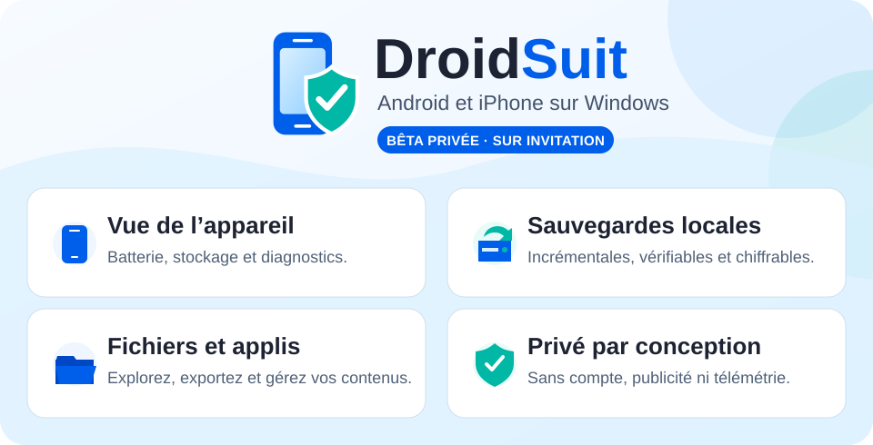

  <strong>Nous concevons des logiciels et des sites web, guidés par la création, la passion et l’utilité.</strong> 
  Des idées explorées, des interfaces travaillées et des outils construits autour d’un usage concret.

  <a href="https://kloups.fr"><strong>Découvrir le studio ↗</strong></a>&nbsp;&nbsp; / &nbsp;&nbsp;
  <a href="https://github.com/orgs/Kloups-Dev/repositories">Parcourir les dépôts ↗</a>&nbsp;&nbsp; / &nbsp;&nbsp;
  <a href="#sites-et-outils-web">Sites et outils web ↓</a>

 

## Projets principaux

### DroidSuit

Gérez vos appareils Android et iPhone depuis Windows. Les sauvegardes et les exports restent sur votre ordinateur. Les fonctions disponibles varient selon la plateforme.

**Bêta privée sur invitation** · [Voir le projet ↗](https://github.com/walou444/DroidSuit)

### GameTune

Une application Windows qui réunit des réglages pour PC gaming, des outils de maintenance et des instantanés de configuration.

[Voir sur le Microsoft Store ↗](https://apps.microsoft.com/detail/9p13w9dgw9qc?gl=FR&hl=fr-FR)

## Projets secondaires

<table>
  <tr>
    <td width="42%" valign="top"></td>
    <td valign="top"><strong>Console Launcher</strong> Retrouvez et lancez vos jeux depuis une bibliothèque pour Windows et Linux qui s’appuie sur vos émulateurs. Rust / Qt Quick · Prototype en préversion <a href="https://github.com/Kloups-Dev/console-launcher">Projet ↗</a> · <a href="https://github.com/Kloups-Dev/console-launcher/releases">Versions ↗</a></td>
  </tr>
  <tr>
    <td width="42%" valign="top"></td>
    <td valign="top"><strong>LG Firmware Explorer</strong> Parcourez les ressources d’un firmware et générez des rapports HTML. L’outil s’appuie sur les travaux OpenLGTV. C# / WPF · Préversion publique <a href="https://github.com/Kloups-Dev/lg-firmware-explorer">Projet ↗</a> · <a href="https://github.com/Kloups-Dev/lg-firmware-explorer/releases">Versions ↗</a></td>
  </tr>
  <tr>
    <td width="42%" valign="top"></td>
    <td valign="top"><strong>Focus Heure</strong> Planifiez des créneaux de concentration sur Windows 11, avec compte à rebours et prise en charge de plusieurs écrans. C# · Code source disponible <a href="https://github.com/Kloups-Dev/focus-heure">Projet ↗</a></td>
  </tr>
</table>

## Sites et outils web

| Site | À quoi il sert |
| :--- | :--- |
| **[FiveM Finder ↗](https://fivemfinder.com/)** | Retrouvez des scripts, MLO, véhicules et vêtements FiveM issus de plusieurs plateformes dans une seule recherche. |
| **[Kloups YT DL ↗](https://yt.kloups.fr/)** | Analysez un lien YouTube et choisissez un export vidéo ou audio pour les contenus que vous êtes autorisé à télécharger. |
| **[Knowledge Core ↗](https://kc.kloups.fr/)** | Recherchez dans une base de connaissances techniques et retrouvez les fiches, leurs sources et leurs liens. |

## Langages & outils

Voir la liste des technologies

- **Langages & web** · Rust, TypeScript, JavaScript, Python, C#, HTML, CSS
- **Interfaces & applications** · Qt / QML, React, Next.js, Node.js, Tailwind CSS
- **Infrastructure & livraison** · Linux, Docker, Nginx, Vercel, Git, GitHub

## Le studio

Kloups Studio réunit une pratique indépendante du développement logiciel, du web et de la création numérique. Nous aimons comprendre un besoin, expérimenter une réponse et lui donner une forme simple à utiliser.

**Créer avec curiosité.** Explorer, prototyper et travailler les interfaces autant que leur fonctionnement.

**Construire pour un usage.** Expliquer ce qu’un outil permet de faire, documenter son état et rendre ses limites visibles.

**Garder des choix indépendants.** Choisir les technologies selon les projets et partager le code lorsque le projet s’y prête. Les conditions d’utilisation sont précisées dans chaque dépôt.

 

## Échanger & contribuer

Pour découvrir les autres réalisations et retrouver le studio : **[kloups.fr ↗](https://kloups.fr)**

Pour signaler un problème ou proposer une amélioration, rendez-vous dans les issues du projet concerné et consultez son guide de contribution lorsqu’il existe.

---

<strong>KLOUPS STUDIO</strong> &nbsp; / &nbsp; Logiciels · Web · Outils &nbsp; / &nbsp; France
