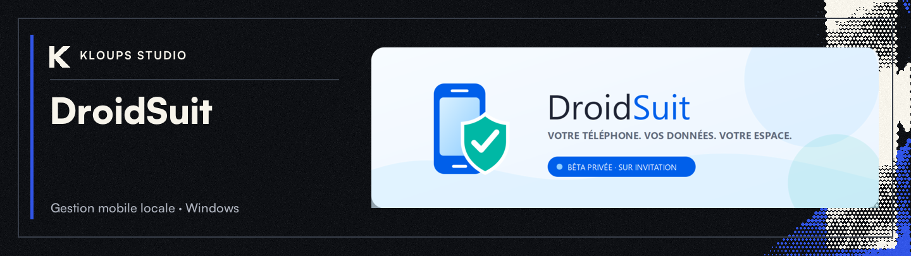
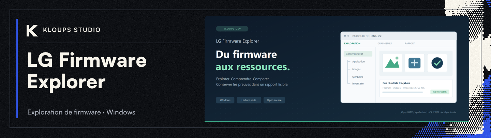
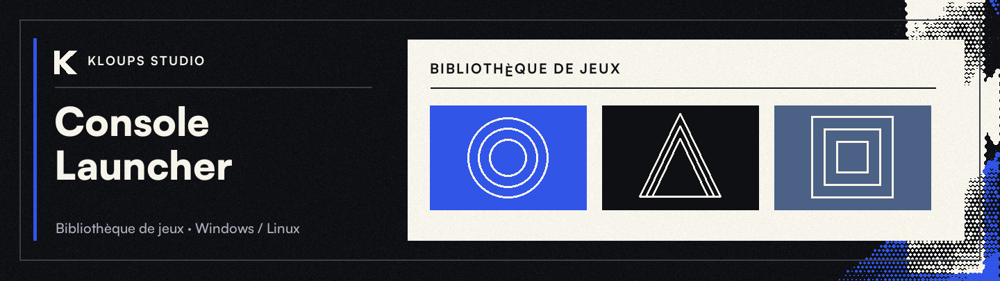
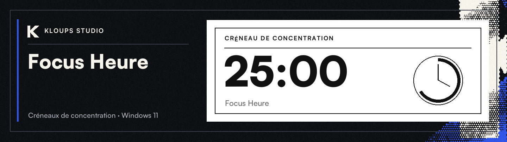
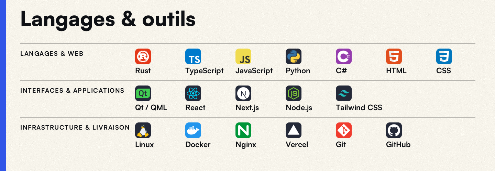

  <strong>Nous concevons des logiciels et des sites web, guidés par la création, la passion et l’utilité.</strong> 
  Des idées explorées, des interfaces travaillées et des outils construits autour d’un usage concret.

  <a href="https://kloups.fr"><strong>Découvrir le studio ↗</strong></a>&nbsp;&nbsp; / &nbsp;&nbsp;
  <a href="https://github.com/orgs/Kloups-Dev/repositories">Parcourir les dépôts ↗</a>

 

## Projets sélectionnés

<table>
  <tr>
    <td width="50%" valign="top">
      
      <h3>DroidSuit</h3>
      
Gérer les données de ses appareils Android et iPhone depuis Windows, en local.

      
WINDOWS · BÊTA PRIVÉE SUR INVITATION

      
<a href="https://github.com/walou444/DroidSuit">Explorer le projet →</a>

    </td>
    <td width="50%" valign="top">
      
      <h3>LG Firmware Explorer</h3>
      
Parcourir un firmware, consulter ses ressources et produire des rapports HTML. Le projet s’appuie sur les travaux OpenLGTV.

      
C# / WPF · PRÉVERSION PUBLIQUE

      
<a href="https://github.com/Kloups-Dev/lg-firmware-explorer">Explorer le projet →</a> · <a href="https://github.com/Kloups-Dev/lg-firmware-explorer/releases">Voir les versions →</a>

    </td>
  </tr>
  <tr>
    <td width="50%" valign="top">
      
      <h3>Console Launcher</h3>
      
Retrouver et lancer ses jeux depuis une bibliothèque pour Windows et Linux qui s’appuie sur les émulateurs existants.

      
RUST / QT QUICK · PROTOTYPE EN PRÉVERSION

      
<a href="https://github.com/Kloups-Dev/console-launcher">Explorer le projet →</a> · <a href="https://github.com/Kloups-Dev/console-launcher/releases">Voir les versions →</a>

    </td>
    <td width="50%" valign="top">
      
      <h3>Focus Heure</h3>
      
Définir des créneaux de concentration sur Windows 11, avec compte à rebours, notifications et prise en charge de plusieurs écrans.

      
C# / WINDOWS · CODE SOURCE DISPONIBLE

      
<a href="https://github.com/Kloups-Dev/focus-heure">Explorer le projet →</a>

    </td>
  </tr>
</table>

## Langages & outils

Voir la liste des technologies

- **Langages & web** · Rust, TypeScript, JavaScript, Python, C#, HTML, CSS
- **Interfaces & applications** · Qt / QML, React, Next.js, Node.js, Tailwind CSS
- **Infrastructure & livraison** · Linux, Docker, Nginx, Vercel, Git, GitHub

## Le studio

Kloups Studio réunit une pratique indépendante du développement logiciel, du web et de la création numérique. Nous aimons comprendre un besoin, expérimenter une réponse et lui donner une forme simple à utiliser.

**Créer avec curiosité.** Explorer, prototyper et travailler les interfaces autant que leur fonctionnement.

**Construire pour un usage.** Expliquer ce qu’un outil permet de faire, documenter son état et rendre ses limites visibles.

**Garder des choix indépendants.** Choisir les technologies selon les projets et partager le code lorsque le projet s’y prête. Les conditions d’utilisation sont précisées dans chaque dépôt.

 

## Échanger & contribuer

Pour découvrir les autres réalisations et retrouver le studio : **[kloups.fr ↗](https://kloups.fr)**

Pour signaler un problème ou proposer une amélioration, rendez-vous dans les issues du projet concerné et consultez son guide de contribution lorsqu’il existe.

---

<strong>KLOUPS STUDIO</strong> &nbsp; / &nbsp; Logiciels · Web · Outils &nbsp; / &nbsp; France
